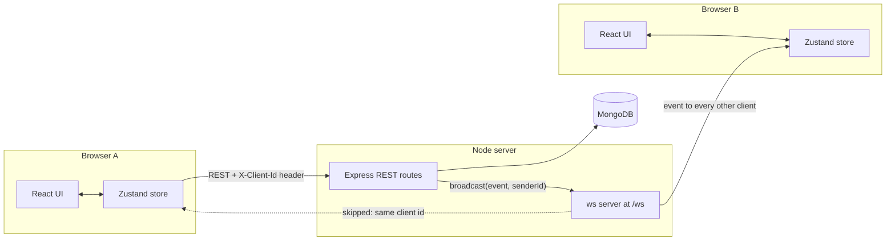
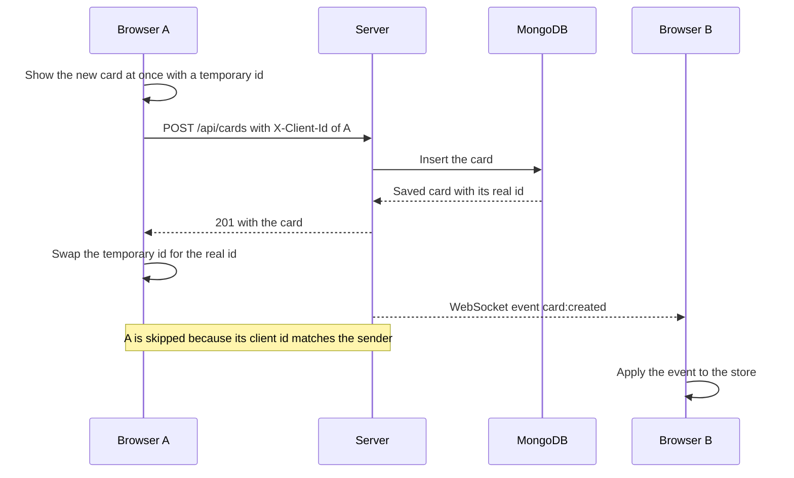
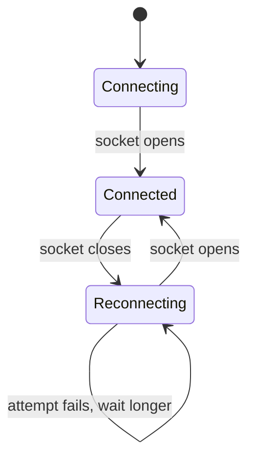

# Real-Time Collaborative Kanban Board

A Kanban board (UI name: **Cardstock**) where every change appears in all open browser windows within moments, without a refresh. Changes also feel instant to the person making them, and if the server rejects or cannot be reached, the screen rolls back and says so.

**Live demo:**  `https://card-stock-gules.vercel.app/`

## Contents

1. [Overview](#overview)
2. [Features](#features)
3. [Tech stack](#tech-stack)
4. [Folder structure](#folder-structure)
5. [Architecture](#architecture)
6. [Accessibility](#accessibility)
7. [Getting started](#getting-started)
8. [Environment variables](#environment-variables)
9. [Testing](#testing)
10. [Design decisions and trade-offs](#design-decisions-and-trade-offs)
11. [Known limitations](#known-limitations)
12. [Deployment](#deployment)
13. [Post-deploy checklist](#post-deploy-checklist)

## Overview

The project has two independent packages:

- **`server/`** is a Node.js REST API backed by MongoDB. After every successful change it broadcasts an event over a WebSocket to the other connected clients.
- **`client/`** is a React single-page app. It keeps the board in a small Zustand store, applies the user's actions optimistically, and applies other people's changes as they arrive over the WebSocket.

There is a single shared board: no accounts, no multiple boards.

## Features

- Columns and cards: add, rename or edit, and delete. Deleting a column also deletes its cards (after a confirmation prompt).
- Drag and drop cards within a column and between columns, with the mouse, touch, or the keyboard.
- Screen-reader announcements during a drag that use the real card and column titles.
- Real-time sync across all open windows through a WebSocket.
- Optimistic updates for every action, with automatic rollback and an error toast on failure.
- Temporary ids for new items, replaced by the server's ids once saved.
- Automatic reconnect with exponential backoff and jitter, and a full board reload after every (re)connect so nothing missed is lost.
- Connection indicator (Connecting / Live / Reconnecting).
- Loading and error states, including a "Try again" button when the first load fails.
- Semantic HTML, visible focus styles, a skip link, `prefers-reduced-motion` support, and a layout that stacks columns on small screens and, on wider ones, places them side by side and wraps them onto new rows, so there is no horizontal scrollbar.

## Tech stack

| Area | Technology |
| --- | --- |
| Server | Node.js 20+, Express 5, TypeScript (strict), Mongoose 8 (MongoDB), Zod, `ws` |
| Client | React 19, TypeScript (strict), Vite 7, Zustand 5, dnd-kit, Tailwind CSS v4 (`@tailwindcss/vite`) |
| Unit and component tests | Vitest, React Testing Library, jsdom, user-event |
| End-to-end tests | Playwright (Chromium only) |
| Database | MongoDB (local or Atlas) |

## Folder structure

```
kanban-board/
├── README.md
├── .gitignore
├── server/
│   ├── .env.example
│   ├── package.json
│   ├── package-lock.json
│   ├── tsconfig.json
│   └── src/
│       ├── index.ts              # starts MongoDB, the HTTP server and the WebSocket server
│       ├── app.ts                # Express app (CORS, routes, error handling), no side effects
│       ├── config.ts             # validates environment variables with Zod
│       ├── realtime.ts           # WebSocket server, heartbeat, broadcast()
│       ├── schemas.ts            # Zod schemas for every body, param and WebSocket message
│       ├── serializers.ts        # Mongoose document -> API shape ({ id, ... })
│       ├── http.ts               # parseWith() validation helper, X-Client-Id reader
│       ├── errors.ts             # HttpError
│       ├── types.ts              # DTOs and the ServerEvent union
│       ├── middleware/errorHandler.ts
│       ├── models/{Column.ts, Card.ts}
│       └── routes/{board.ts, columns.ts, cards.ts}
└── client/
    ├── .env.example
    ├── package.json
    ├── package-lock.json
    ├── tsconfig.json
    ├── vite.config.ts            # also holds the Vitest configuration
    ├── playwright.config.ts
    ├── index.html
    ├── e2e/
    │   ├── realtime.spec.ts      # two windows: create, move, rollback
    │   ├── keyboard.spec.ts      # keyboard drag and drop, focus handling
    │   ├── layout.spec.ts        # columns wrap into rows, no sideways scrollbar
    │   └── support/{env.ts, api.ts, fixtures.ts, board.ts}
    └── src/
        ├── main.tsx
        ├── App.tsx               # loading / error / board states, opens the socket
        ├── App.test.tsx
        ├── index.css             # Tailwind import and design tokens
        ├── config.ts             # API/WS URLs and this tab's CLIENT_ID
        ├── types.ts              # mirrors server/src/types.ts
        ├── components/           # Board, ColumnView, CardItem, AddItemForm, ConnectionStatus, Toasts
        ├── hooks/                # useBoardSocket.ts, usePrefersReducedMotion.ts
        ├── lib/                  # api.ts, board.ts (pure helpers), events.ts, focus.ts, ids.ts (+ board.test.ts)
        ├── store/                # boardStore.ts, connectionStore.ts, toastStore.ts (+ boardStore.test.ts)
        └── test/                 # setup.ts, helpers.ts (fake fetch and WebSocket)
```

`server/src/types.ts` and `client/src/types.ts` describe the same wire format. Change them together.

## Architecture

### Overview diagram



Writes go through REST. The WebSocket is used only to push events from the server to clients (the server does not accept board changes over it).

### REST API

Every request and response is JSON. Errors always look like `{ "error": { "message": "...", "details": ... } }`; `details` carries Zod's field errors for validation failures (HTTP 400). Every body and every `:id` parameter is validated with Zod, and unknown body keys are rejected.

| Method and path | Body | Result |
| --- | --- | --- |
| `GET /api/health` | none | `{ status, database }` |
| `GET /api/board` | none | `{ columns: [{ id, title, position }], cards: [{ id, columnId, title, description, position }] }` |
| `POST /api/columns` | `{ title }` (1-100 chars) | `201` with the column |
| `PATCH /api/columns/:id` | `{ title }` | the updated column |
| `DELETE /api/columns/:id` | none | `204`; also deletes the column's cards |
| `POST /api/cards` | `{ columnId, title, description? }` (title 1-200, description up to 2000) | `201` with the card |
| `PATCH /api/cards/:id` | `{ title?, description? }` (at least one) | the updated card |
| `PATCH /api/cards/:id/move` | `{ columnId, position }` | `{ cards }`: all cards of the affected columns |
| `DELETE /api/cards/:id` | none | `204` |

For the move endpoint, `position` is the **index in the target column**. The server clamps it to the valid range and renumbers the positions of the target column (and the source column, if different) to exactly `0..n-1`.

### Real-time events

After each successful REST change the server broadcasts one event to every connected client except the sender.

| Event | Payload |
| --- | --- |
| `column:created`, `column:updated` | `{ column }` |
| `column:deleted` | `{ id }` (receivers also drop that column's cards locally) |
| `card:created`, `card:updated` | `{ card }` |
| `card:deleted` | `{ id, columnId }` |
| `cards:reordered` | `{ columnIds, cards }`: every card of the affected columns |

`cards:reordered` lists the affected column ids because a column that just lost its last card has no cards in the payload, so receivers need the ids to know which columns to replace wholesale.

The WebSocket endpoint is `/ws`. The server pings every client every 30 seconds and terminates sockets that did not answer the previous ping, so half-open connections do not pile up. Any message a client sends is validated with Zod; the only accepted message is `{ "type": "ping" }`, answered with `{ "type": "pong" }`. (The current client relies on the browser's automatic answer to protocol pings and does not send this message.)

### How X-Client-Id prevents echo

Each browser tab generates a random `CLIENT_ID` once per page load (`client/src/config.ts`). It is sent as the `X-Client-Id` header on every REST request and as `?clientId=` when the WebSocket connects. When a REST handler calls `broadcast(event, senderClientId)`, the server skips every socket whose client id equals the sender's.

The sender already applied its change optimistically, so receiving the same change again would be redundant and could briefly flicker the UI. Two tabs in the same browser have different ids, so they sync with each other. If the header is missing (for example when using `curl`), the event goes to everyone.



### Optimistic update and rollback

All six mutations (add, rename or edit, delete, for columns and cards, plus move) go through one function in `client/src/store/boardStore.ts`. The steps are:

1. Save a snapshot of the current columns and cards.
2. Apply the change to the store, so the screen updates immediately. New items get a temporary id (prefix `tmp-`).
3. Send the API request.
4. On success, apply the server's answer. For a create, swap the temporary id for the server's id; for a move, replace the affected columns with the server's list.
5. On failure, restore the snapshot and show an error toast (an `alert` live region).
6. When no other change is still in flight and a refetch was requested, quietly reload `GET /api/board`.

```mermaid
flowchart TD
  start(["User action"]) --> snap["Save a snapshot of columns and cards"]
  snap --> apply["Apply the change to the store, UI updates at once"]
  apply --> call["Send the API request"]
  call -->|"success"| ok["Apply the server's answer, for example swap the temporary id"]
  call -->|"failure"| rb["Restore the snapshot and show an error toast"]
  rb --> flag["Request a refetch"]
  ok --> idle{"Other changes still in flight?"}
  flag --> idle
  idle -->|"no, and a refetch is waiting"| refetch["Quiet refetch of GET /api/board"]
  idle -->|"otherwise"| done(["Done"])
  refetch --> done
```

Details that keep this safe:

- Items with a temporary id cannot be edited, deleted or dragged until the server has saved them (the card shows "Saving…"). A card also cannot be added to a column that is still unsaved.
- A board response that was requested before a newer request is ignored.
- A refetch that arrives while a change is still in flight is held back and re-run once everything has settled. Otherwise it could briefly show the old state of the pending change.
- Applying a `cards:reordered` event or a move response keeps cards that still have a temporary id, because the server cannot know about them yet.

### Reconnect flow

`client/src/hooks/useBoardSocket.ts` keeps one WebSocket open while the app is mounted.



- **Backoff:** the wait before attempt *n* (starting at 0) is `min(15 s, 500 ms × 2ⁿ)`, then randomised to between half and the full value ("jitter"). So the waits are about 0.25-0.5 s, 0.5-1 s, 1-2 s, 2-4 s, 4-8 s, 7.5-15 s, and then stay at 7.5-15 s. Jitter prevents every browser from retrying at the same instant after a server restart.
- **Refetch on every (re)connect:** events broadcast while a client was offline are gone for good, so each time the socket opens the client reloads the whole board. This also happens on the very first connect.
- A successful connect resets the attempt counter. Closing the app (unmounting) stops further retries.

### Drag and drop

The board uses dnd-kit with a pointer sensor (a 5 px movement threshold, so a plain click never starts a drag) and a keyboard sensor. The drag handle is the only drag activator, so the Edit and Delete buttons keep working normally.

With the keyboard, focus a card's drag handle and press Space to pick it up. **Up and Down** reorder it inside its column, **Left and Right** carry it to the previous or next column in display order, including an empty one and the first column of the next row when columns wrap, Space drops it and Escape cancels. This is a custom coordinate getter in `Board.tsx` (`createKeyboardCoordinates`). Up and Down reuse dnd-kit's `sortableKeyboardCoordinates` limited to the current column, but Left and Right go by column order instead of screen position, because a position-based search finds nothing "to the right" of the last column in a row. After a keyboard drop or cancel, focus is put back on the card's handle, since its element is rebuilt in its new place.

While a card is being dragged, it is moved between lists in a **local working copy** only. The store and the server are touched exactly once, when the card is dropped, so crossing three columns sends one request, not three.

## Accessibility

The UI was audited against WCAG 2.2 AA. What is in place:

- **Keyboard:** every action (add, edit, rename, delete, move) works without a mouse. Opening or closing a form moves focus into it and back to the button that opened it. After deleting a card or column, focus moves to a neighbour instead of dropping to the page body. A skip link jumps to the board.
- **Names and labels:** every field has a visible or spoken label, forms are grouped with a legend that names the card or column, and buttons that repeat in every column say which one they belong to (for example "Add card to To do").
- **Live announcements:** drag and drop announces the real card and column titles. Errors appear in an `alert` toast that stays while the pointer or focus is on it. The connection badge and the loading placeholder are `status` regions.
- **Structure:** one `h1`, column titles as `h2`, card titles as `h3`, a `header`, a `main`, and one labelled region per column.
- **Contrast and focus:** text meets 4.5:1 and the edge of text fields meets 3:1. Every control shows a 3 px focus ring.
- **Motion:** `prefers-reduced-motion` switches off CSS transitions and animations, and the drag drop-animation, which runs in JavaScript.

Not done: moving a card still requires a drag gesture (with the mouse or the keyboard). A click-only alternative such as a "Move to column" menu would satisfy WCAG 2.5.7 and is listed under known limitations.

## Getting started

### Prerequisites

- Node.js 20.19 or newer (Vite 7 requires it).
- A MongoDB instance: a local one, or a free MongoDB Atlas cluster. To run one locally with Docker: `docker run -d --name kanban-mongo -p 27017:27017 mongo:7`.

### 1. Server

```bash
cd server
cp .env.example .env      # then edit MONGODB_URI if needed
npm install
npm run dev               # REST on http://localhost:4000/api, WebSocket on ws://localhost:4000/ws
```

### 2. Client (in a second terminal)

```bash
cd client
cp .env.example .env
npm install
npm run dev               # http://localhost:5173
```

Open the client in two browser windows to see the real-time sync.

### Scripts

| Package | Script | What it does |
| --- | --- | --- |
| server | `npm run dev` | Runs the server with `tsx` and restarts it on file changes |
| server | `npm run build` | Compiles TypeScript to `dist/` |
| server | `npm start` | Runs the compiled server (`node dist/index.js`) |
| server | `npm run typecheck` | Type-checks without emitting files |
| client | `npm run dev` | Starts the Vite dev server |
| client | `npm run build` | Type-checks, then builds to `dist/` |
| client | `npm run preview` | Serves the production build locally |
| client | `npm run typecheck` | Type-checks without emitting files |
| client | `npm test` / `npm run test:watch` | Unit and component tests (once / in watch mode) |
| client | `npm run test:e2e` | Playwright end-to-end tests |

## Environment variables

### Server (`server/.env`)

| Variable | Required | Default | Description |
| --- | --- | --- | --- |
| `PORT` | no | `4000` | Port for HTTP and WebSocket |
| `MONGODB_URI` | **yes** | none | MongoDB connection string. Include the database name, for example `.../kanban` |
| `CLIENT_ORIGIN` | no | `http://localhost:5173` | Origin(s) allowed by CORS. Comma-separated for several. Must match exactly: scheme, host and port, with **no trailing slash** |

The server validates these at startup and exits with a clear message if they are invalid.

### Client (`client/.env`)

| Variable | Default | Description |
| --- | --- | --- |
| `VITE_API_URL` | `http://localhost:4000` | Base URL of the API. No `/api` suffix; a trailing slash is removed automatically |
| `VITE_WS_URL` | `ws://localhost:4000/ws` | Full WebSocket URL including `/ws`. Use `wss://` when the site is served over HTTPS |

Vite reads `VITE_*` variables **at build time** and bakes them into the bundle, so changing them on a hosting platform requires a new build.

### Tests

| Variable | Default | Description |
| --- | --- | --- |
| `E2E_MONGODB_URI` | `mongodb://127.0.0.1:27017/kanban_e2e` | Database used by the Playwright tests. Read from the shell, not from `.env` files. The database name must contain `e2e` |

## Testing

### Unit and component tests (Vitest)

```bash
cd client
npm test
```

These run in jsdom with `fetch` and `WebSocket` replaced by fakes, so **no server or database is needed**. They cover:

- Rendering the board from API data, including the loading state.
- Adding a card: the optimistic card appears immediately and the temporary id is replaced by the server's id.
- Rollback with an error toast when the API fails or cannot be reached.
- The store's `applyEvent` for `card:created`, `card:deleted` and `cards:reordered`.
- The local move/reorder helper: same column, across columns, and index clamping.
- The connection badge, refetch on connect, applying events from the socket, and reconnect.

### End-to-end tests (Playwright)

Prerequisites:

- MongoDB running (default `127.0.0.1:27017`).
- Dependencies installed in both `server/` and `client/`.
- Chromium installed once: `npx playwright install chromium` (add `--with-deps` on a fresh Linux machine).
- Ports `4100` and `5174` free.

```bash
cd client
npm run test:e2e
```

Playwright starts its own server (port 4100) and client (port 5174) using the `webServer` entries in `playwright.config.ts`, and never reuses an already-running server, so your development setup is not involved. The tests use the database `kanban_e2e`, or the one in `E2E_MONGODB_URI`.

> **Warning:** each test starts by deleting every column and card in the test database. The run refuses to start unless the database name contains `e2e`.

`realtime.spec.ts` opens two separate browser contexts and checks that a created card and a moved card appear in the other window, and that blocking the API (`page.route` abort) rolls back the optimistic change and shows an error toast. `keyboard.spec.ts` moves cards with the keyboard only: across columns (including an empty one), up and down inside a column, cancelling with Escape, that focus returns to the card's handle, and that the result is saved on the server. `layout.spec.ts` checks that columns wrap onto new rows at several window widths without a horizontal scrollbar, and that Left/Right still reach columns on the next row. On failure, open the report with `npx playwright show-report`.

The server has no automated tests yet.

## Design decisions and trade-offs

### Integer positions vs fractional indexing

Cards and columns have an integer `position`. The move endpoint takes an index and renumbers the affected columns to `0..n-1`.

- **Why:** it is easy to understand and debug, the "position" the client sends is exactly the index it sees, and the order is always contiguous.
- **Cost:** a move rewrites the position of every card that shifted, so it is O(n) writes per affected column, and those writes are not atomic.
- **Alternative:** fractional indexing (a position between its neighbours, such as the midpoint of two numbers or an ordered string) makes a move a single write and handles simultaneous moves better. It needs a rebalancing strategy once precision runs out, and the data is harder to read. For boards with tens of cards, the simpler option was chosen.

### Snapshot rollback vs per-action undo

On failure the client restores a snapshot of the whole board taken before the action.

- **Why:** one code path for every action, and no risk of forgetting an inverse operation when a new action is added.
- **Cost:** if other changes were applied while the request was in flight (for example an event from a teammate), restoring the snapshot would also undo them. That is why a failure requests a quiet refetch afterwards, which brings the screen back in line with the server.
- **Alternative:** per-action undo (apply the exact inverse of that one change) is more precise but needs an inverse for each action and careful ordering when several actions are pending.

### Last-write-wins

There are no version numbers, ETags or locks. If two people edit the same card at once, the request that reaches the server last overwrites the other. Two simultaneous moves are resolved the same way, with ties in position ordered by `_id` so the result is deterministic.

- **Why:** it keeps the API and the UI simple, and for a small team board conflicts are rare and harmless.
- **Cost:** a person can lose an edit without being told. Fixing it properly means versioning plus a conflict UI.

### Other choices

- **REST for writes, WebSocket only for pushing events.** Validation, error handling and optimistic rollback all work from ordinary request/response results. The socket is a one-way notification channel.
- **Refetch instead of replaying missed events.** There are no event sequence numbers or history, and a reload of the whole board after every connect is simpler and always correct. It is wasteful for large boards.
- **`ws` instead of Socket.IO.** Fewer moving parts and no custom protocol. Reconnection, which Socket.IO would provide, is written explicitly in the client hook.
- **Express app separate from the server start-up** (`app.ts` vs `index.ts`), so the app can be imported without opening ports or connecting to a database.

## Known limitations

- **No authentication or authorization.** Anyone who can reach the site can read and change the board. The client id is a random label, not a security token, and the WebSocket server does not check the request origin.
- **One shared board.** There are no accounts, multiple boards or permissions.
- **Columns cannot be reordered.** A column's position is set when it is created.
- **Last-write-wins** for concurrent edits (see above). A card edit form that is open while someone else changes the same card will overwrite their change when saved.
- **Renumbering is not transactional.** A move updates cards one by one; if the process fails midway, positions in that column may be inconsistent until the next move. Deleting a column and then its cards is also two separate operations.
- **Single server instance.** Broadcasting uses an in-memory list of sockets. Running several instances would need a shared publish/subscribe layer, such as Redis, so events reach clients connected to other instances.
- **Missed events are recovered by full refetch**, not replay.
- **Unsaved items are locked.** A card or column that is still being created cannot be edited, deleted or dragged until the server answers.
- **Deleting a card** leaves a gap in the positions (harmless; the next move in that column renumbers it). Card deletion has no confirmation, while column deletion uses the browser's `confirm` dialog.
- **No rate limiting or pagination.**
- **Test coverage.** Drag and drop is exercised only by the Playwright tests (mouse and keyboard), because jsdom cannot perform real drags. The server has no automated tests yet.
- **Moving a card needs a drag gesture.** There is no click-only alternative such as a "Move to column" menu (WCAG 2.5.7, new in 2.2). The keyboard route exists.
- **Fonts** are loaded from Google Fonts in `client/index.html`, so the first paint depends on that external request.
- **Free hosting tiers** may stop an idle server. The first request after a pause can be slow, and the client reconnects on its own.

## Deployment

The recommended setup is MongoDB Atlas for the database, Render for the server and Vercel for the client. Deploy in this order, because each step needs the URL from the previous one.

### 1. MongoDB Atlas

1. Create a cluster (the free tier is enough).
2. Under **Database Access**, create a database user with a strong password. If the password contains special characters, URL-encode them in the connection string.
3. Under **Network Access**, allow Render to connect. Render's free instances do not have fixed outbound IPs, so the simplest option is `0.0.0.0/0` (anywhere). This is only acceptable with a strong password; restrict it if your Render plan offers static outbound IPs.
4. Copy the connection string and **add the database name** after the host:
   `mongodb+srv://<user>:<password>@<cluster>.mongodb.net/kanban?retryWrites=true&w=majority`

### 2. Server on Render

Create a **Web Service** from your repository with these settings:

| Setting | Value |
| --- | --- |
| Root Directory | `server` |
| Runtime | Node |
| Build Command | `npm install --include=dev && npm run build` |
| Start Command | `npm start` |
| Health Check Path | `/api/health` |

The `--include=dev` flag matters: the build needs `typescript`, which is a dev dependency.

Environment variables:

| Variable | Value |
| --- | --- |
| `MONGODB_URI` | The Atlas connection string from step 1 |
| `CLIENT_ORIGIN` | Your Vercel URL, for example `https://your-app.vercel.app`. No trailing slash. Separate several origins with commas |

Do not set `PORT`: Render provides it and the server reads it. WebSockets work on the same port, and the service is reachable as `https://<service>.onrender.com` (REST) and `wss://<service>.onrender.com/ws` (WebSocket).

If you do not know the Vercel URL yet, deploy with a temporary `CLIENT_ORIGIN`, then update it after step 3. Render redeploys when an environment variable changes.

### 3. Client on Vercel

Import the repository as a project with these settings:

| Setting | Value |
| --- | --- |
| Root Directory | `client` |
| Framework Preset | Vite |
| Build Command | `npm run build` |
| Output Directory | `dist` |

Environment variables (set them **before** the first build):

| Variable | Value |
| --- | --- |
| `VITE_API_URL` | `https://<service>.onrender.com` |
| `VITE_WS_URL` | `wss://<service>.onrender.com/ws` |

Use `wss://`, not `ws://`: a page served over HTTPS may not open an unencrypted WebSocket, and the browser will block it.

Because Vite bakes these values in at build time, changing them later requires a redeploy. The app is a single page with no client-side routes, so no rewrite rules are needed.

Once Vercel gives you the final URL, put it in `CLIENT_ORIGIN` on Render (step 2) if you have not already.

### Common problems

- **CORS errors in the browser console:** `CLIENT_ORIGIN` does not exactly match the page's origin (check for a trailing slash, `http` vs `https`, or a preview-deployment URL that is not listed).
- **Badge stuck on "Reconnecting…":** `VITE_WS_URL` is wrong, uses `ws://` on an HTTPS site, or is missing `/ws`.
- **First request is slow after a quiet period:** the free server instance was paused and is starting up.
- **Server fails to start on Render with a configuration message:** `MONGODB_URI` is missing or invalid. The log lists the problem.
- **Server starts but requests fail with database errors:** the Atlas network access list or user credentials need fixing.

## Post-deploy checklist

- [ ] `https://<service>.onrender.com/api/health` returns `{"status":"ok","database":"connected"}`.
- [ ] Opening the Vercel URL loads the board, and the badge shows **Live**.
- [ ] In the browser dev tools, the Network tab shows a `wss://` connection to `/ws` with status 101.
- [ ] No CORS errors in the console while adding a column and a card.
- [ ] Open the site in two separate windows: a card created, edited, moved and deleted in one appears in the other without a refresh.
- [ ] Reload one window: the data persists (it comes from Atlas).
- [ ] Switch a window to **Offline** in the dev tools Network tab and add a card: it appears, then disappears with an error toast. Switch back online and confirm the badge returns to **Live**.
- [ ] Leave the site idle long enough for the server to pause, then use it again and confirm it reconnects and shows current data.
- [ ] The Atlas collections `columns` and `cards` contain the data you created.
- [ ] Replace the demo and screenshot placeholders at the top of this README.
