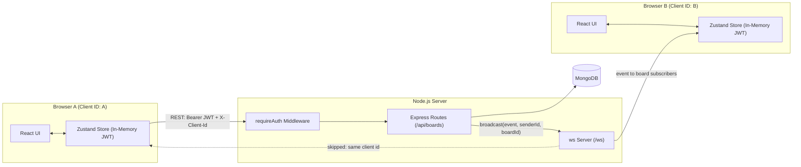
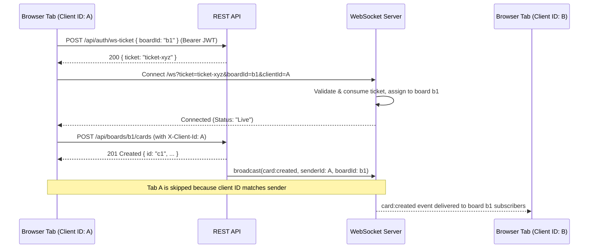

# Real-Time Collaborative Kanban Board (Cardstock)

A modern, production-ready Kanban board (**Cardstock**) featuring secure user authentication, multiple board workspaces, per-user data isolation, and live synchronization across all open browser windows without page reloads. Changes feel instantaneous through optimistic client-side updates, backed by automatic rollback on failure and accessible screen-reader alerts.

**Live demo:** `https://card-stock-gules.vercel.app/`

---

## Contents

1. [Overview](#overview)
2. [Features](#features)
3. [Tech Stack](#tech-stack)
4. [Folder Structure](#folder-structure)
5. [Architecture](#architecture)
   - [Overview Diagram](#overview-diagram)
   - [REST API Reference](#rest-api-reference)
   - [WebSocket Ticket Handshake & Events](#websocket-ticket-handshake--events)
   - [Authentication & Token Security Design](#authentication--token-security-design)
   - [Why Same-Origin via Vercel Rewrite](#why-same-origin-via-vercel-rewrite)
   - [Optimistic Update & Rollback Flow](#optimistic-update--rollback-flow)
   - [Reconnection Flow](#reconnection-flow)
   - [Drag and Drop](#drag-and-drop)
6. [Accessibility (WCAG 2.2 AA)](#accessibility-wcag-22-aa)
7. [Getting Started](#getting-started)
8. [Orphaned Data Migration](#orphaned-data-migration)
9. [Environment Variables](#environment-variables)
10. [Testing](#testing)
11. [Design Decisions and Trade-Offs](#design-decisions-and-trade-offs)
12. [Known Limitations](#known-limitations)
13. [Deployment](#deployment)
    - [1. MongoDB Atlas](#1-mongodb-atlas)
    - [2. Server on Render](#2-server-on-render)
    - [3. Client on Vercel](#3-client-on-vercel)
14. [Post-Deploy Checklist](#post-deploy-checklist)

---

## Overview

The repository is organized into two primary applications with a shared root scripts configuration:

- **`server/`**: A Node.js REST API + WebSocket server backed by MongoDB. Authenticates users, enforces board ownership and authorization, persists data, issues single-use WebSocket tickets, and broadcasts real-time board mutations to connected clients.
- **`client/`**: A React single-page application built with Vite and Tailwind CSS. Keeps the board state in a Zustand store, holds short-lived JWT access tokens strictly in memory, rotates refresh tokens seamlessly via HttpOnly cookies, applies changes optimistically, and syncs live updates over WebSocket connections.

---

## Features

- **Authentication & Security:**
  - Email and password registration with case-insensitive normalization and duplicate detection.
  - Timing-safe login comparisons (constant-time bcrypt verification regardless of whether the email exists) returning identical generic error messages.
  - Short-lived JWT access tokens (15-minute TTL) stored strictly in-memory in Zustand to mitigate token theft via Cross-Site Scripting (XSS).
  - Rotating refresh tokens (7-day TTL) delivered in `HttpOnly`, `SameSite=Lax`, `Path=/api/auth` cookies.
  - Refresh token family revocation: replaying a previously rotated-out token immediately revokes the entire token family.
  - WebSocket ticket handshake: single-use 60s tickets tied to board ownership; connections without a valid ticket are terminated within 5 seconds.
  - Rate limiting on auth endpoints (10 requests per 15 minutes) and security headers via Helmet.
- **Multi-Board Management & Isolation:**
  - Create, view, rename, and delete multiple boards per user.
  - Direct routing (`/boards` and `/boards/:boardId`) with client-side SPA route guards.
  - Strict authorization: User B receives HTTP `404 Not Found` (never `403`) when attempting to access User A's boards, columns, or cards, preventing resource enumeration.
  - Automatic default board creation when a new user registers.
- **Columns & Cards:**
  - Add, inline-rename, and delete columns and cards.
  - Cascade deletions: deleting a board removes all its columns and cards; deleting a column removes all its cards.
  - Contiguous integer renumbering (`0..n-1`) and `{ cards }` payload return for wholesale column replacement.
  - Drag and drop cards within a column and across columns via mouse, touch, or accessible keyboard navigation (Space, Arrow keys, Escape).
- **Real-Time Collaboration:**
  - Real-time updates push instantly across all connected windows subscribed to the same board.
  - Board-scoped WebSocket channels: clients connected to Board A never receive events from Board B.
  - `X-Client-Id` suppression prevents echoing the sender's own changes back to the origin tab.
  - Automatic reconnection with exponential backoff and jitter, plus quiet full-board re-sync on reconnect.
- **Accessibility (WCAG 2.2 AA):**
  - Keyboard navigation for every interaction, visible focus rings, skip links, and ARIA live regions for screen-reader announcements.
  - `prefers-reduced-motion` support disabling all animations and transitions.

---

## Tech Stack

| Layer | Technologies |
| :--- | :--- |
| **Server** | Node.js 20+, Express 5, TypeScript (strict), Mongoose 8 (MongoDB), Zod, `ws`, `jsonwebtoken`, `bcryptjs`, `helmet`, `express-rate-limit`, `cookie-parser` |
| **Client** | React 19, TypeScript (strict), Vite 7, React Router 7, Zustand 5, `@dnd-kit/core`, `@dnd-kit/sortable`, Tailwind CSS v4 (`@tailwindcss/vite`) |
| **Testing** | Vitest, Supertest, `mongodb-memory-server` (pinned binary `7.0.14`), React Testing Library, jsdom, Playwright (Chromium) |
| **Database** | MongoDB (local or MongoDB Atlas) |

---

## Folder Structure

```
kanban-board/
├── package.json                  # Root convenience scripts (test, typecheck, build, test:e2e)
├── README.md
├── MANUAL_CHECKLIST.md
├── .gitignore
├── server/
│   ├── .env.example              # Server environment template with openssl secret instructions
│   ├── package.json
│   ├── tsconfig.json
│   ├── scripts/
│   │   └── migrateOrphans.ts     # Migration CLI for pre-auth legacy columns and cards
│   ├── src/
│   │   ├── index.ts              # Starts MongoDB, Express HTTP server, and WebSocket server
│   │   ├── app.ts                # Express app (Helmet, CORS, routes, error handling)
│   │   ├── config.ts             # Zod environment variable validation
│   │   ├── realtime.ts           # WebSocket server, ticket verification, heartbeats, broadcast()
│   │   ├── schemas.ts            # Zod validation schemas for requests and params
│   │   ├── serializers.ts        # Mongoose document -> API DTO transformers
│   │   ├── http.ts               # parseWith() validation helper and X-Client-Id extraction
│   │   ├── errors.ts             # HttpError class
│   │   ├── types.ts              # Shared DTOs and ServerEvent interfaces
│   │   ├── auth/
│   │   │   ├── tokens.ts         # JWT access token signing/verification & refresh token hashing
│   │   │   ├── password.ts       # bcrypt hashing and timing budget verification
│   │   │   └── cookie.ts         # HttpOnly refresh cookie helpers
│   │   ├── middleware/
│   │   │   ├── authenticate.ts   # requireAuth Bearer token middleware
│   │   │   └── errorHandler.ts   # Centralized HTTP error handler
│   │   ├── models/               # User.ts, Board.ts, Column.ts, Card.ts, RefreshToken.ts
│   │   └── routes/
│   │       ├── auth.ts           # /api/auth (register, login, refresh, logout, me, ws-ticket)
│   │       ├── boards.ts         # /api/boards (board CRUD, nested column/card endpoints)
│   │       └── board.ts          # /api/board (legacy user-scoped default board endpoints)
│   └── tests/                    # auth.test.ts, boards.test.ts, board.test.ts, websocket.test.ts, migration.test.ts
└── client/
    ├── .env.example              # Client environment template
    ├── vercel.json               # Vercel configuration with /api rewrite to Render and SPA fallback
    ├── package.json
    ├── vite.config.ts            # Vite 7 + Vitest configuration
    ├── playwright.config.ts      # Playwright test configuration with webServer orchestration
    ├── index.html
    ├── e2e/                      # Playwright test specs
    │   ├── auth.spec.ts          # UI register/login, board isolation, logout socket termination
    │   ├── realtime.spec.ts      # Multi-window live sync, card moves, offline rollback
    │   ├── keyboard.spec.ts      # Keyboard drag-and-drop, focus retention, Escape cancel
    │   ├── layout.spec.ts        # Responsive wrapping, no horizontal scroll
    │   └── support/              # env.ts, api.ts (scoped helpers), fixtures.ts, board.ts
    └── src/
        ├── main.tsx
        ├── App.tsx               # App router, session restoration, toast container
        ├── config.ts             # API/WS URLs and random tab CLIENT_ID
        ├── types.ts              # Client types mirroring server DTOs
        ├── components/           # Board, ColumnView, CardItem, ProtectedRoute, Header, Toasts, styles
        ├── hooks/                # useBoardSocket.ts, usePrefersReducedMotion.ts
        ├── pages/                # AuthPage.tsx, BoardsPage.tsx, BoardPage.tsx
        ├── store/                # authStore.ts, boardsStore.ts, boardStore.ts, connectionStore.ts, toastStore.ts
        └── lib/                  # api.ts (with 401 retry deduplication), board.ts, events.ts, ids.ts, focus.ts
```

---

## Architecture

### Overview Diagram



Writes proceed via REST. The WebSocket is dedicated to real-time broadcast notifications from the server to subscribed clients.

---

### REST API Reference

All requests and responses use JSON. Unauthenticated board requests return `401 Unauthorized`. Unauthorized requests targeting another user's board return `404 Not Found` (never `403 Forbidden`) to prevent resource enumeration.

#### Authentication Endpoints (`/api/auth`)

| Method and Path | Body | Auth Required | Description |
| :--- | :--- | :---: | :--- |
| `POST /api/auth/register` | `{ email, password }` | No | Creates an account, generates default board, returns `{ user, accessToken }` and sets HttpOnly refresh cookie. |
| `POST /api/auth/login` | `{ email, password }` | No | Verifies credentials (timing-safe), returns `{ user, accessToken }` and sets HttpOnly refresh cookie. |
| `POST /api/auth/refresh` | None (reads cookie) | No | Validates Origin header, rotates refresh token, returns `{ user, accessToken }` and sets new cookie. |
| `POST /api/auth/logout` | None (reads cookie) | No | Validates Origin header, deletes current refresh token, and clears cookie (`204`). |
| `POST /api/auth/logout-all` | None | Bearer Token | Revokes all refresh token sessions across all devices for this user (`204`). |
| `GET /api/auth/me` | None | Bearer Token | Returns current authenticated `{ user: { id, email } }`. |
| `POST /api/auth/ws-ticket` | `{ boardId }` | Bearer Token | Verifies board ownership and generates a single-use 60s ticket `{ ticket }` for `/ws`. |

#### Board Endpoints (`/api/boards`)

| Method and Path | Body | Description |
| :--- | :--- | :--- |
| `GET /api/boards` | None | Lists all boards owned by the user `[{ id, title, createdAt }]` (auto-creates default if empty). |
| `POST /api/boards` | `{ title }` | Creates a new board (`201`). |
| `GET /api/boards/:boardId` | None | Retrieves board summary, columns, and cards `{ id, title, columns, cards }`. |
| `PATCH /api/boards/:boardId` | `{ title }` | Renames the board. |
| `DELETE /api/boards/:boardId` | None | Deletes board and cascades deletion to all associated columns and cards (`204`). |

#### Board-Scoped Columns & Cards (`/api/boards/:boardId/...`)

| Method and Path | Body | Description |
| :--- | :--- | :--- |
| `POST /api/boards/:boardId/columns` | `{ title }` | Creates a column in the board (`201`). |
| `PATCH /api/boards/:boardId/columns/:id` | `{ title }` | Renames the column. |
| `DELETE /api/boards/:boardId/columns/:id` | None | Deletes column and cascades deletion to its cards (`204`). |
| `POST /api/boards/:boardId/cards` | `{ columnId, title, description? }` | Creates a card in the specified column (`201`). |
| `PATCH /api/boards/:boardId/cards/:id` | `{ title?, description? }` | Updates card title or description. |
| `PATCH /api/boards/:boardId/cards/:id/move` | `{ columnId, position }` | Moves card to index `position` in `columnId`. Returns `{ cards }` (all cards in affected columns, contiguous `0..n-1`). |
| `DELETE /api/boards/:boardId/cards/:id` | None | Deletes the card (`204`). |

---

### WebSocket Ticket Handshake & Events

1. **Ticket Acquisition:** Before opening a WebSocket connection, the client requests a ticket via `POST /api/auth/ws-ticket` using its in-memory access token. The server validates that the user owns `boardId` and returns a cryptographically random, single-use ticket.
2. **Connection:** The client connects to `/ws?ticket=<ticket>&boardId=<boardId>&clientId=<clientId>`.
3. **Validation & Timeout:** The server verifies the ticket in memory. If valid, the ticket is immediately consumed (preventing replay attacks), the socket is bound to `boardId`, and connection is marked active. Unauthenticated or ticketless connections are terminated after **5 seconds**.
4. **Board Isolation:** Broadcasts generated by mutations on Board A are distributed exclusively to sockets connected to Board A. Sockets connected to Board B never receive them.
5. **Client Echo Suppression:** If `X-Client-Id` on the REST call matches the socket's `clientId`, the server suppresses echoing the event back to the origin tab.



---

### Authentication & Token Security Design

- **Access Token in Memory:** Access tokens are short-lived (15 minutes) signed JWTs. They are held strictly in JavaScript memory inside the Zustand `authStore` and are **never** stored in `localStorage`, `sessionStorage`, or `IndexedDB`. This ensures that malicious scripts (XSS) cannot steal persistent credentials from browser storage.
- **Rotating Refresh Token Cookie:** Refresh tokens are 48-byte cryptographically random strings. Only the SHA-256 hash is stored in MongoDB. The token is sent to the client as an `HttpOnly`, `SameSite=Lax`, `Path=/api/auth` cookie.
- **Token Rotation & Family Revocation:** Each call to `POST /api/auth/refresh` issues a new access token, generates a new refresh token, updates the cookie, and marks the old refresh token as used (`isUsed: true`). If an attacker attempts to replay a previously rotated token, the server immediately revokes all refresh tokens sharing that `familyId`, terminating all sessions for that device family.
- **In-Flight Refresh Coalescing:** The client library (`client/src/lib/api.ts`) wraps `refreshToken()` in a deduplicated in-flight promise (`inFlightAuthRefresh`). When parallel requests encounter 401s or when React Strict Mode mounts components concurrently, all callers share a single `POST /api/auth/refresh` request, eliminating race conditions.

---

### Why Same-Origin via Vercel Rewrite

Modern browsers enforce strict third-party cookie restrictions (e.g. Chrome Privacy Sandbox, Safari ITP). When a frontend on Vercel (`https://card-stock.vercel.app`) calls a backend on Render (`https://card-stock.onrender.com`) directly, cross-origin requests treat cookies as third-party.

To solve this cleanly, [client/vercel.json](file:///c:/Users/DELL/OneDrive/Desktop/kanban-boardF/kanban-board/client/vercel.json) configures reverse proxy rewrites:

```json
{
  "rewrites": [
    {
      "source": "/api/:path*",
      "destination": "https://<your-render-service>.onrender.com/api/:path*"
    },
    {
      "source": "/(.*)",
      "destination": "/index.html"
    }
  ]
}
```

**Benefits:**
1. **First-Party Cookies:** Requests to `/api/auth/...` are sent to the same origin (`https://card-stock.vercel.app/api/...`), so `SameSite=Lax` cookies are treated as first-party and are never blocked.
2. **No CORS Preflight Overhead:** Normal REST API calls require no CORS preflights.
3. **SPA Routing:** `/(.*)` rewrites all non-API paths to `/index.html`, allowing direct navigation and reloads on `/boards`, `/boards/:boardId`, `/login`, and `/register`.

---

### Optimistic Update & Rollback Flow

1. Capture a snapshot of the current columns and cards.
2. Apply the change immediately to the Zustand store (temporary IDs prefixed with `tmp-`).
3. Dispatch the API request with the `Authorization: Bearer <token>` and `X-Client-Id` headers.
4. On success: swap temporary IDs for server IDs, or update positions from the response `{ cards }`.
5. On failure: restore the snapshot, show an error alert toast, and trigger a quiet refetch of the board.

---

### Reconnection Flow

`client/src/hooks/useBoardSocket.ts` maintains a live socket for the active board:
- **Exponential Backoff with Jitter:** Retries after disconnect with randomized delays (`0.5s` up to `15s`).
- **Fresh Tickets on Reconnect:** Every reconnection attempts to acquire a new single-use ticket via `POST /api/auth/ws-ticket`.
- **Quiet Re-Sync:** When the socket opens, the client refetches the active board silently to recover any events broadcast during the disconnect.

---

### Drag and Drop

- Powered by `@dnd-kit/core` and `@dnd-kit/sortable`.
- Pointer sensor uses a 5px activation threshold so clicks on edit/delete buttons do not trigger drags.
- Keyboard sensor (`Space` to pick up, `Arrow` keys to move across columns and rows, `Space` to drop, `Escape` to cancel).
- Focus is restored to the drag handle after reordering.

---

## Accessibility (WCAG 2.2 AA)

- **Keyboard Navigation:** Full operation without a mouse across board list, board canvas, modals, and auth forms.
- **Skip Links:** "Skip to main content", "Skip to board", and "Skip to form" links for assistive technology users.
- **ARIA Live Regions:** Error announcements (`role="alert"`), connection status updates (`role="status"`), and screen-reader drag announcements.
- **Form Controls:** Validated inputs with `aria-invalid`, `aria-describedby` pointing to error descriptions, and accessible password reveal toggles.
- **Motion:** `prefers-reduced-motion` suppresses animations and transitions.

---

## Getting Started

### Prerequisites

- Node.js 20.19+ (Vite 7 compatible).
- MongoDB instance (local or MongoDB Atlas).

### 1. Root Installation

Install dependencies from the repository root:

```bash
# In kanban-board/
npm run test           # Runs all server and client unit tests
npm run typecheck      # Runs TypeScript checks across both packages
npm run build          # Builds production bundles for server and client
```

### 2. Server Setup

```bash
cd server
cp .env.example .env
npm install
npm run dev            # REST: http://localhost:4000/api, WS: ws://localhost:4000/ws
```

### 3. Client Setup

```bash
cd client
cp .env.example .env
npm install
npm run dev            # http://localhost:5173
```

---

## Orphaned Data Migration

If your database contains columns or cards created **before authentication was introduced** (documents with no `userId`), run the migration script:

```bash
cd server

# 1. Dry run (read-only inspection)
npm run migrate:orphans

# 2. Assign all orphaned items to a registered user
npm run migrate:orphans -- --assign-to alice@example.com

# 3. Or delete all orphaned items permanently
npm run migrate:orphans -- --delete
```

The script is safe, idempotent, and requires `MONGODB_URI` in `server/.env`.

---

## Environment Variables

### Server (`server/.env`)

Generate secrets using `openssl rand -base64 48`:

| Variable | Required | Default | Description |
| :--- | :---: | :--- | :--- |
| `PORT` | No | `4000` | Port for HTTP and WebSocket servers (Render assigns this automatically). |
| `NODE_ENV` | No | `development` | Environment mode: `development`, `production`, or `test`. |
| `MONGODB_URI` | **Yes** | None | MongoDB connection string including database name. |
| `CLIENT_ORIGIN` | No | `http://localhost:5173` | Allowed CORS origins (comma-separated, no trailing slash). |
| `JWT_ACCESS_SECRET` | **Yes** | None | Secret for signing 15m JWT access tokens (>= 32 chars). Generate: `openssl rand -base64 48`. |
| `JWT_REFRESH_SECRET`| **Yes** | None | Secret for refresh token hashing (>= 32 chars, different from access secret). Generate: `openssl rand -base64 48`. |
| `COOKIE_SECURE` | No | `false` | Set to `true` behind HTTPS/TLS (always `true` in production). |

### Client (`client/.env`)

| Variable | Default | Description |
| :--- | :--- | :--- |
| `VITE_API_URL` | `http://localhost:4000` | Base URL of the REST API (leave unset or empty string if using Vercel rewrites). |
| `VITE_WS_URL` | `ws://localhost:4000/ws` | Full WebSocket URL. Use `wss://` in production over HTTPS. |

---

## Testing

All tests are verified and automated:

### Run Everything from Root

```bash
npm run test         # Runs server Vitest (59 tests) + client Vitest (55 tests)
npm run typecheck    # Full TypeScript typecheck (server + client)
npm run build        # Production builds (server + client)
npm run test:e2e     # Runs Playwright E2E suite (12 tests)
```

### Server Integration Tests (59 tests)

```bash
cd server
npm test
```
*Tests use an in-memory database (`mongodb-memory-server` pinned to `7.0.14`) and cover auth flows, token rotation, family revocation, origin checks, rate limiting, board CRUD, 404 user isolation, cascade deletions, WebSocket ticket timeouts, and migrations.*

### Client Unit Tests (55 tests)

```bash
cd client
npm test
```
*Tests run in jsdom with mocked fetch and WebSocket. Covers `authStore` actions, `restoreSession`, `ProtectedRoute` redirection, `api.ts` deduplicated 401 refresh/retry, `AuthPage` form validations and ARIA alerts, and `BoardsPage` CRUD.*

### Playwright End-to-End Tests (12 tests)

```bash
cd client
npm run test:e2e
```
*Requires MongoDB running locally. Orchestrates isolated test users, verifies UI registration/login, cross-user board isolation, real-time sync across independent browser windows, logout socket termination, and keyboard drag-and-drop.*

---

## Design Decisions and Trade-Offs

- **Access Token in Memory vs LocalStorage:** Keeping tokens in JavaScript memory prevents persistent XSS token theft. Page reloads restore tokens automatically via the secure HttpOnly refresh cookie.
- **Token Rotation with Family Revocation:** Every token refresh invalidates the previous token. If an invalid or previously used token is received, the server revokes all tokens belonging to that user's session family, neutralizing stolen refresh tokens.
- **WebSocket Handshake Tickets:** Sockets cannot be authenticated via standard HTTP headers during the initial upgrade request in standard browser APIs. Generating a short-lived, single-use ticket via authenticated REST (`POST /api/auth/ws-ticket`) guarantees that only users with authorized access to a board can connect to its WebSocket channel.
- **404 Instead of 403 for Unauthorized Boards:** If User B attempts to access User A's board or nested resources, the server responds with `404 Not Found` rather than `403 Forbidden`. This conceals the existence of private boards from unauthorized users.

---

## Known Limitations

- **Column Reordering:** Column ordering is determined when columns are created; moving columns via drag-and-drop is not currently implemented.
- **Single Server WebSocket Hub:** Real-time event broadcasting uses an in-memory socket registry. Scaling horizontally across multiple server instances requires a shared publish/subscribe message broker (such as Redis).
- **Click-Only Drag Alternative:** Reordering cards requires a pointer drag or keyboard navigation. A context-menu click alternative ("Move to column...") would satisfy WCAG 2.5.7.
- **External Web Fonts:** Outfit and Plus Jakarta Sans are fetched from Google Fonts in `index.html`.

---

## Deployment

### 1. MongoDB Atlas

1. Create a free M0 cluster.
2. Under **Database Access**, create a user with read/write privileges.
3. Under **Network Access**, add `0.0.0.0/0` (or your static outbound IPs).
4. Copy the connection URI and include the database name: `mongodb+srv://<user>:<password>@<cluster>.mongodb.net/kanban?retryWrites=true&w=majority`.

### 2. Server on Render

Create a **Web Service** pointing to the repository:

| Setting | Value |
| :--- | :--- |
| Root Directory | `server` |
| Runtime | Node |
| Build Command | `npm install --include=dev && npm run build` |
| Start Command | `npm start` |
| Health Check Path | `/api/health` |

**Environment Variables:**

| Variable | Value |
| :--- | :--- |
| `NODE_ENV` | `production` |
| `MONGODB_URI` | Your MongoDB Atlas connection string |
| `CLIENT_ORIGIN` | `https://<your-vercel-app>.vercel.app` (no trailing slash) |
| `JWT_ACCESS_SECRET` | 48-byte secret generated via `openssl rand -base64 48` |
| `COOKIE_SECURE` | `true` |
| `TRUST_PROXY_HOPS` | `2` (when traffic routes via Vercel rewrites -> Render proxy) or `1` (if calling Render directly) |

*(Render automatically assigns `PORT`)*.

> [!NOTE]
> **Proxy Hops & Rate Limiting Verification:**
> Because the production deployment path is **Vercel rewrite -> Render**, incoming HTTP requests traverse two reverse proxy hops: Vercel Edge Proxy, then Render's internal load balancer. Setting `TRUST_PROXY_HOPS=2` instructs Express to extract the original client IP from `X-Forwarded-For` across both hops so that rate limiting (`authLimiter`) isolates individual users instead of blocking the entire proxy pool.
>
> **Temporary Verification (remove after confirming):**
> To verify `req.ip` in production: temporarily log `console.log("Resolved IP:", req.ip, "X-Forwarded-For:", req.headers["x-forwarded-for"])` inside the `GET /api/health` handler in `server/src/app.ts`, trigger the health endpoint from your browser, and check the Render dashboard logs to confirm `req.ip` reflects your public client IP rather than an internal proxy address (`10.x.x.x`). Remove the debug line after verifying.

### 3. Client on Vercel

Import the repository as a **Vercel** project:

| Setting | Value |
| :--- | :--- |
| Root Directory | `client` |
| Framework Preset | Vite |
| Build Command | `npm run build` |
| Output Directory | `dist` |

**Configuration & Rewrites:**
The repository includes [client/vercel.json](file:///c:/Users/DELL/OneDrive/Desktop/kanban-boardF/kanban-board/client/vercel.json), which proxies `/api/*` requests directly to your Render backend:

```json
{
  "rewrites": [
    {
      "source": "/api/:path*",
      "destination": "https://<your-render-service>.onrender.com/api/:path*"
    },
    {
      "source": "/(.*)",
      "destination": "/index.html"
    }
  ]
}
```

Update `<your-render-service>` in `client/vercel.json` with your Render domain, and set:

| Variable | Value |
| :--- | :--- |
| `VITE_WS_URL` | `wss://<your-render-service>.onrender.com/ws` |

*(Note: `VITE_API_URL` is omitted or empty so that all REST requests route through the same-origin Vercel rewrite).*

---

## Post-Deploy Checklist

- [ ] `https://<service>.onrender.com/api/health` returns `{"status":"ok","database":"connected"}`.
- [ ] Navigating to the Vercel URL loads the application and presents `/login`.
- [ ] User registration works: creates an account and redirects to `/boards`.
- [ ] Creating a board navigates to `/boards/:boardId` and connection status badge displays **Live**.
- [ ] Opening the same board in two windows reflects card creation and drag-and-drop in real time without refreshing.
- [ ] Logging out redirects to `/login` and terminates the WebSocket connection.
- [ ] Registering a second user confirms that User A's boards are invisible to User B.
